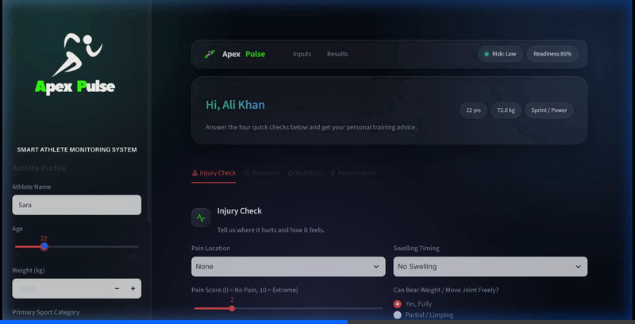
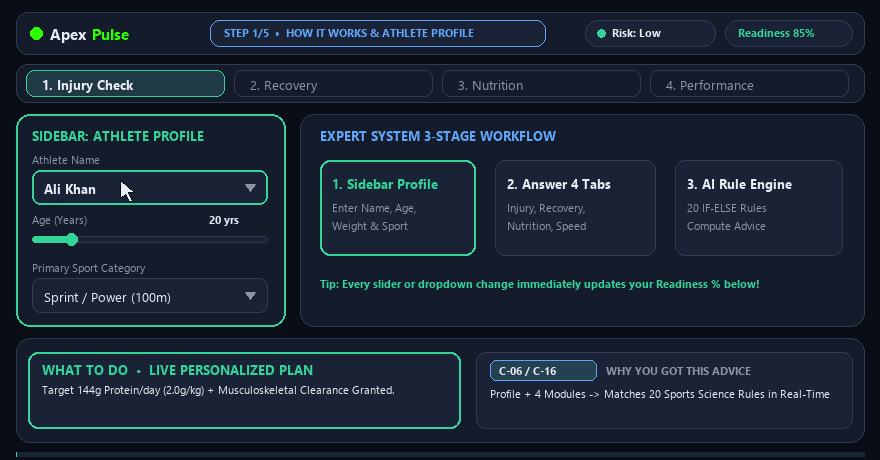
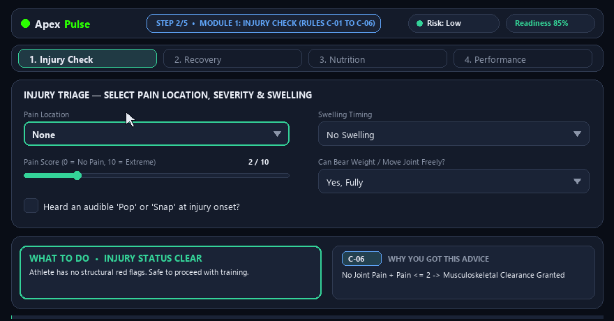
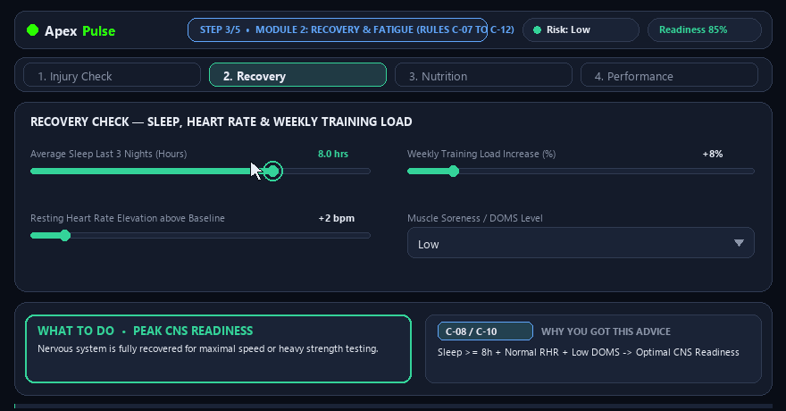
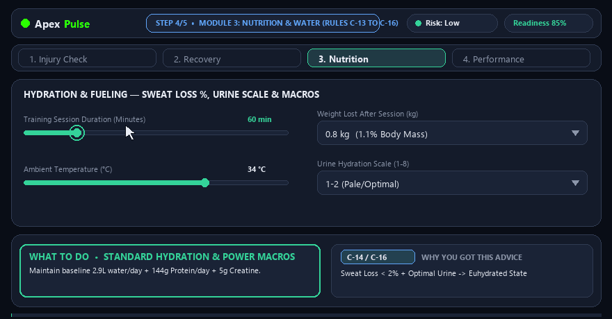
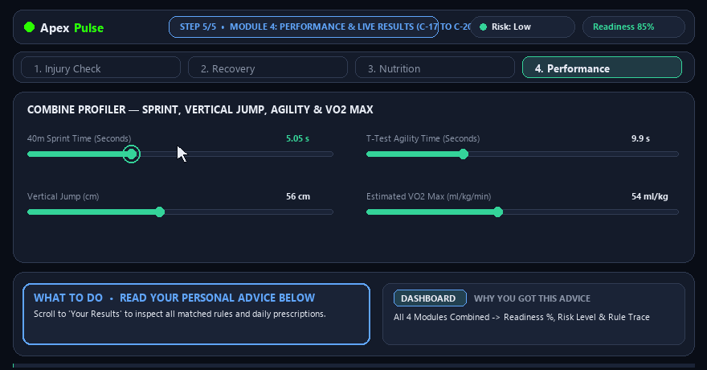
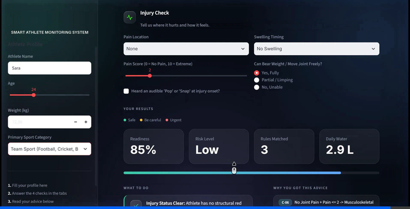
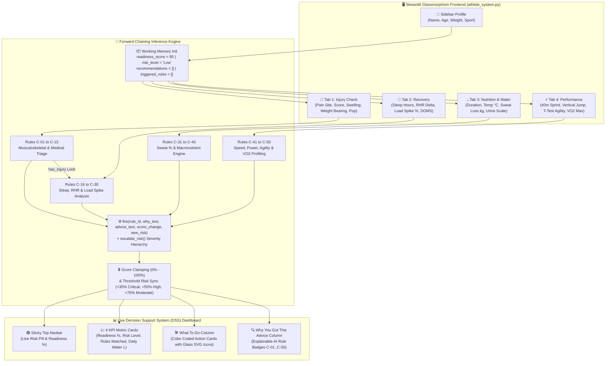

<div align="center">


# ⚡ APEX PULSE

**An Explainable 50-Rule Forward-Chaining AI Expert System & Real-Time Decision Support System (DSS) for Smart Athlete Monitoring, Built with Python & Streamlit**

[](https://www.python.org/)
[](https://streamlit.io/)
[](#%EF%B8%8F-architecture--workflow-diagram)
[](#%EF%B8%8F-50-rule-knowledge-base-summary-c-01-to-c-50)
[](https://python-pillow.org/)

<br />



</div>

---

## 📖 Overview & Core Concept

**Apex Pulse** is an interactive **Rule-Based Expert System** and **Decision Support System (DSS)** engineered for sports science, injury triage, fatigue management, hydration planning, and athletic performance profiling.

Instead of acting as a "black-box" calculator, **Apex Pulse** uses a transparent **Forward-Chaining Inference Engine** powered by **50 domain-specific `IF-ELIF-ELSE` production rules (`C-01` to `C-50`)**. Every time an athlete or coach adjusts a symptom, sleep metric, sweat loss value, or sprint time, the system evaluates active facts in working memory, computes a dynamic **Readiness Score (`0% – 100%`)**, escalates the **Risk Level (`Low` → `Moderate` → `High` → `Critical`)**, and outputs both **Actionable Coaching Advice (*What to do*)** and a full **Explainable AI Rule Trace (*Why you got this advice*)**.

### 🔄 Core User Journey & Workflow
1. **Configure Athlete Baseline (Sidebar):** Enter the athlete's name, age (`15–45`), body weight (`40–130 kg`), and primary sport category (*Sprint / Power*, *Team Sport*, or *Endurance*).
2. **Module 1 — Injury Check (`C-01` to `C-15`):** Report joint/muscle pain location (*Knee, Ankle, Hamstring, Shoulder, Lower Back*), pain severity (`0–10`), swelling onset timing, weight-bearing ability, mechanical pop/snap sounds, concussion symptoms, or fever.
3. **Module 2 — Recovery & Fatigue (`C-16` to `C-30`):** Input 3-night average sleep hours, resting heart rate elevation (`+bpm` above baseline), weekly training load spike (`%`), and muscle soreness (`DOMS`).
4. **Module 3 — Nutrition & Hydration (`C-31` to `C-40`):** Log session duration, ambient temperature (`°C`), post-session weight lost as sweat (`kg`), and urine hydration color scale (`1–8`).
5. **Module 4 — Performance Profiling (`C-41` to `C-50`) & Live DSS Dashboard:** Enter `40m Sprint`, `Vertical Jump`, `T-Test Agility`, and `VO2 Max` scores to receive instant role recommendations, readiness progress bars, daily fluid targets, and color-coded clinical/coaching cards.

---

## 🖼️ Visual Showcase / Screenshots Gallery

### 🎞️ Interactive Module Walkthroughs (Animated GIFs)

| 1️⃣ Profile & System Overview | 2️⃣ Injury Triage & Red-Flag Detection |
| :---: | :---: |
|  |  |
| *Sidebar biometric profiling, live top-bar status pills, and hero greeting card.* | *Real-time musculoskeletal rule matching (`C-01`–`C-15`) for Knee, Ankle, Hamstring, Shoulder & Back.* |

| 3️⃣ Recovery, Sleep & Load Spike Analysis | 4️⃣ Hydration, Sweat Loss & Sport Nutrition |
| :---: | :---: |
|  |  |
| *Autonomic nervous system fatigue tracking (`C-16`–`C-30`) via sleep debt, RHR delta & DOMS.* | *Automated sweat percentage calculation (`C-31`–`C-40`), 1.5x fluid replacement & macro targets.* |

### 📸 High-Resolution Interface Views

| 5️⃣ Athletic Performance & Role Profiling | 6️⃣ Explainable DSS Dashboard & Rule Trace |
| :---: | :---: |
|  |  |
| *Speed, explosive power, agility & aerobic capacity evaluation (`C-41`–`C-50`).* | *Color-coded recommendations paired 1-to-1 with triggered rule IDs (`rule-badge`) and readiness bars.* |

---

## ✨ Key Features (Mapped to Real Code)

### 🧠 1. Forward-Chaining Inference Engine & Working Memory
- **Working Memory Initialization (`athlete_system.py`):** Starts every evaluation cycle with a clean baseline (`readiness_score = 85`, `risk_level = "Low"`, `recommendations = []`, `triggered_rules = []`).
- **Rule Execution Handler (`fire()` in `athlete_system.py`):** Central inference function `fire(rule_id, why_text, advice_text, score_change=0, new_risk=None)` that mutates working memory whenever a rule's antecedent (`if / elif` condition) evaluates to `True`:
  - Appends `(rule_id, why_text)` to `triggered_rules` for the Explainable AI audit trail.
  - Appends actionable coaching guidance to `recommendations`.
  - Applies additive/subtractive readiness penalties or bonuses (`score_change`) and clamps the final score via `max(0, min(100, readiness_score))`.
- **Monotonic Risk Escalation (`escalate_risk()` in `athlete_system.py`):** Uses a strict severity hierarchy (`{"Low": 0, "Moderate": 1, "High": 2, "Critical": 3}`) so a lower-severity rule can never downgrade an active `"Critical"` or `"High"` alert. Automatically syncs final risk level when readiness drops below `<35%` (`Critical`), `<55%` (`High`), or `<75%` (`Moderate`).

### 🛡️ 2. Cross-Tab Safety Locks & Smart Module Isolation
- **Contradiction Prevention Guard (`has_injury` in `athlete_system.py`):** Tracks whether the athlete reported any structural injury, concussion, or fever in Tab 1. If `has_injury` is `True`, positive "train hard / high intensity" recovery rules (`C-17`, `C-25`, `C-30`) are automatically blocked from firing.
- **Active Tab Isolation (`tab1_used`, `tab2_used`, `tab3_used`, `tab4_used` in `athlete_system.py`):** Detects which module tabs the user has actively modified so untouched tabs do not pollute the Explainable AI trace with default rules.

### 🩺 3. Four Specialized Domain Modules (50 Rules: `C-01` to `C-50`)
- **Tab 1 — Musculoskeletal & Medical Triage (`C-01` to `C-15`):** Covers complete severity ladders (`Critical` → `High` → `Moderate` → `Mild`) for **Knee** (`C-01`–`C-04`, including ACL pop + immediate effusion), **Ankle** (`C-05`–`C-07`, Ottawa fracture indicators & sprains), **Hamstring** (`C-08`–`C-09`), **Shoulder** (`C-10`), **Lower Back** (`C-11`), **Concussion** (`C-12`), and **Fever/Systemic Illness** (`C-13`).
- **Tab 2 — Sleep, Autonomic Recovery & Training Load (`C-16` to `C-30`):** Evaluates sleep debt (`<5h`, `5–7h`, `8h+`), resting heart rate elevation (`+4 to +20 bpm`), weekly load spikes (`>10%`, `>20% + Severe DOMS`, `>35%`), senior recovery needs (`age > 32`, `C-27`), and youth growth-plate protection (`age <= 18`, `C-28`).
- **Tab 3 — Biometric Hydration & Sport Macronutrients (`C-31` to `C-40`):** Dynamically computes percentage body weight lost as sweat (`sweat_pct = (sweat_loss_kg / weight) * 100`), prescribes `1.5x` fluid rehydration (`water_to_drink = max(1.0, sweat_loss_kg * 1.5)`), checks heat stress (`temp_c >= 35°C`, `C-35`) and cold warm-up protocols (`temp_c <= 15°C`, `C-36`), and calculates exact daily gram targets for carbohydrates (`weight * 8g` or `6g`) and protein (`weight * 2.0g` or `1.6g`).
- **Tab 4 — Athletic Performance & Position Profiling (`C-41` to `C-50`):** Analyzes `sprint_40m`, `vert_jump`, `agility_ttest`, and `vo2_max` to classify athletes into explosive roles (*Winger, Striker, Fast Bowler, 100m Sprinter* in `C-41`), high-engine roles (*Midfielder / All-Rounder* in `C-45`), or targeted conditioning programs (`C-42`–`C-44`, `C-46`–`C-47`, `C-49`).

### 🎨 4. Custom Glassmorphism UI & Inline Vector Graphics
- **Custom Dark Glass Theme (`athlete_system.py` & `.streamlit/config.toml`):** Styled with radial emerald/blue ambient glow gradients, frosted glass cards (`backdrop-filter: blur`), sticky status navbar (`nav_html()`), and high-contrast form controls.
- **Zero-Dependency SVG Icon Engine (`ICONS`, `gicon()`, `_split_emoji()`, `_rec_class()`):** Automatically strips leading emojis from recommendation strings and renders frosted-glass SVG badges color-coded by urgency (`rec-red` for urgent stops, `rec-amber` for caution/load reduction, `rec-green` for optimal readiness).
- **Auto-Cropped Favicon Loader (`_cropped()` in `athlete_system.py`):** Uses `PIL.Image` alpha bounding-box detection (`im.split()[3].getbbox()`) with `@st.cache_resource` to trim transparent padding from `logo/main-tabbar-logo.png`, with automatic fallback if logo files are absent.

---

## 🎮 Usage, CLI Commands & 50-Rule Reference

### 💻 CLI & Execution Commands

| Task / Action | Command | Description |
| :--- | :--- | :--- |
| **Run App (Standard)** | `streamlit run athlete_system.py` | Launches the Apex Pulse web server on `http://localhost:8501`. |
| **Run via Virtual Env (Windows)** | `.\.venv\Scripts\python.exe -m streamlit run athlete_system.py` | Runs Streamlit directly using the local `.venv` Python interpreter. |
| **Install Dependencies** | `pip install -r requirements.txt` | Installs `streamlit>=1.38.0` and `Pillow>=10.0.0`. |

### 🗂️ 50-Rule Knowledge Base Summary (`C-01` to `C-50`)

| Module Tab | Rule IDs | Input Parameters Evaluated | Output & Score Impact |
| :--- | :---: | :--- | :--- |
| **1. Injury Check** | `C-01` – `C-15` *(15 Rules)* | `pain_site`, `pain_severity` (`0–10`), `swelling`, `weight_bearing`, `heard_pop`, `headache_dizzy`, `feeling_sick` | Diagnoses ACL/fracture red flags, sprains, strains & concussions (`-60` to `0` Readiness, `Low` to `Critical` Risk). |
| **2. Recovery** | `C-16` – `C-30` *(15 Rules)* | `sleep_hours` (`3–10h`), `rhr_delta` (`0–20 bpm`), `weekly_load_spike` (`0–60%`), `doms_level`, `age` | Detects autonomic fatigue, overtraining spikes & age-specific recovery needs (`-25` to `+10` Readiness). |
| **3. Nutrition** | `C-31` – `C-40` *(10 Rules)* | `session_mins` (`30–180m`), `temp_c` (`10–45°C`), `sweat_loss_kg` (`0–5kg`), `urine_color`, `weight`, `sport_type` | Calculates sweat loss `%`, `1.5x` fluid replacement liters, heat/cold alerts & exact carb/protein grams (`-20` to `0` Readiness). |
| **4. Performance** | `C-41` – `C-50` *(10 Rules)* | `sprint_40m` (`4.3–6.5s`), `vert_jump` (`30–90cm`), `agility_ttest` (`8.5–13.0s`), `vo2_max` (`35–80`), `weight` | Recommends optimal sport positions, power/speed/stamina drills & joint protection (`-10` to `0` Readiness). |

---

## 🗺️ Architecture / Workflow Diagram



---

## 📂 Project Structure (Annotated Tree)

```text
APEX-PULSE/
├── .streamlit/
│   └── config.toml                                    # Enforces dark base theme, emerald primary accent (#34d399) & dark surface colors
├── assets/
│   ├── tutorial/
│   │   ├── step1_overview.gif                         # Animated walkthrough: Athlete profile & main interface overview
│   │   ├── step1_overview.png                         # High-res screenshot: Hero banner & initial app layout
│   │   ├── step2_injury.gif                           # Animated walkthrough: Tab 1 Injury Check triage rules (C-01 to C-15)
│   │   ├── step2_injury.png                           # Static capture: Musculoskeletal symptom inputs
│   │   ├── step3_recovery.gif                         # Animated walkthrough: Tab 2 Recovery & fatigue rules (C-16 to C-30)
│   │   ├── step3_recovery.png                         # Static capture: Sleep, RHR & training load sliders
│   │   ├── step4_nutrition.gif                        # Animated walkthrough: Tab 3 Hydration & nutrition rules (C-31 to C-40)
│   │   ├── step4_nutrition.png                        # Static capture: Sweat loss & urine hydration scale
│   │   ├── step5_performance.gif                      # Animated walkthrough: Tab 4 Performance testing rules (C-41 to C-50)
│   │   └── step5_results.png                          # High-res screenshot: Live DSS Results Dashboard & Explainable AI trace
│   ├── frame_0.png ... frame_140.png                  # Extracted keyframe snapshots from UI recordings
├── logo/
│   ├── main-tabbar-logo.png                           # Browser tab favicon & sticky navbar brand icon
│   ├── transparentlogo-black-theme-cropped.png        # Primary sidebar brand logo for dark glassmorphism UI
│   ├── transparentlogo-white-theme-cropped.png        # Light-mode variant of the cropped Apex Pulse logo
│   ├── logo(bT).png                                   # Full-resolution dark-background brand logo
│   └── logo(wT).png                                   # Full-resolution white-background brand logo
├── .gitignore                                         # Excludes local .venv/, __pycache__/, and bytecode files
├── athlete_system.py                                  # Main application: Custom CSS, 4 Input Tabs, 50 Rules (C-01..C-50) & DSS Dashboard
├── requirements.txt                                   # Cloud deployment dependencies (streamlit>=1.38.0, Pillow>=10.0.0)
└── README.md                                          # Project documentation, architecture diagram & visual showcase
```

---

## 🚀 Getting Started (Installation & Run Guide)

### 1. Clone the Repository
```bash
git clone https://github.com/Muhammad-wasay/APEX-PULSE.git
cd APEX-PULSE
```

### 2. Create & Activate a Virtual Environment (Recommended)
**Windows (PowerShell):**
```powershell
python -m venv .venv
.\.venv\Scripts\Activate.ps1
```

**macOS / Linux:**
```bash
python3 -m venv .venv
source .venv/bin/activate
```

### 3. Install Required Dependencies
```bash
pip install -r requirements.txt
```

### 4. Launch the Application
```bash
streamlit run athlete_system.py
```
The app will automatically open in your browser at **`http://localhost:8501`**.

---

## 👤 Author

<div align="center">

| **Muhammad Wasay** |
| :---: |
| 🎓 *Introduction to Artificial Intelligence (IAI) — 5th Semester Project* |
| [](https://github.com/Muhammad-wasay) [](https://github.com/Muhammad-wasay/APEX-PULSE) |

</div>
